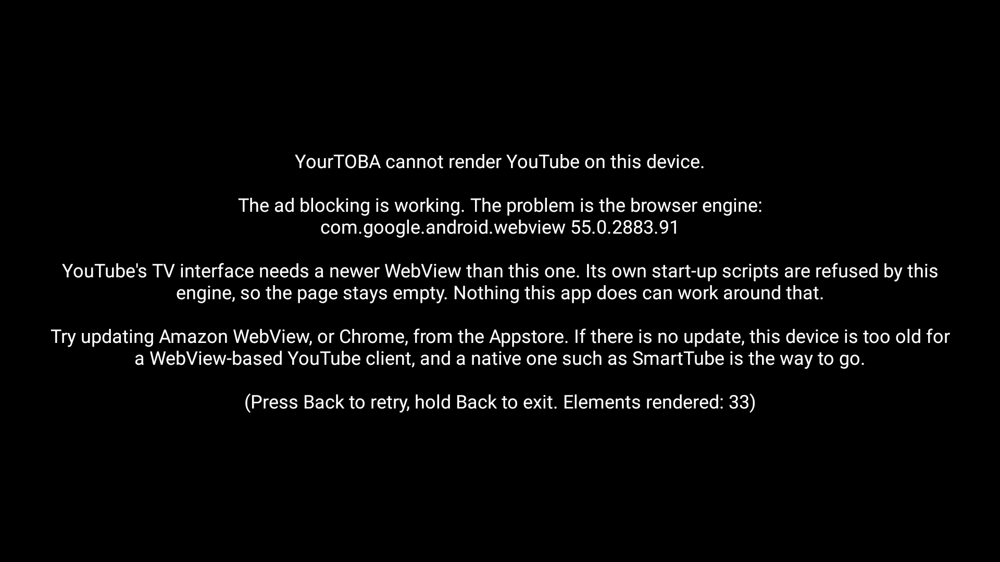
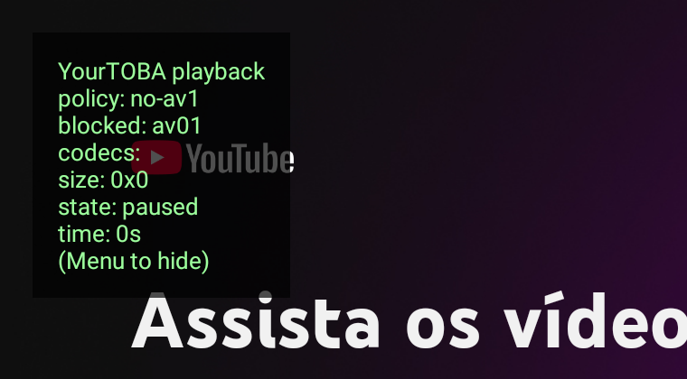
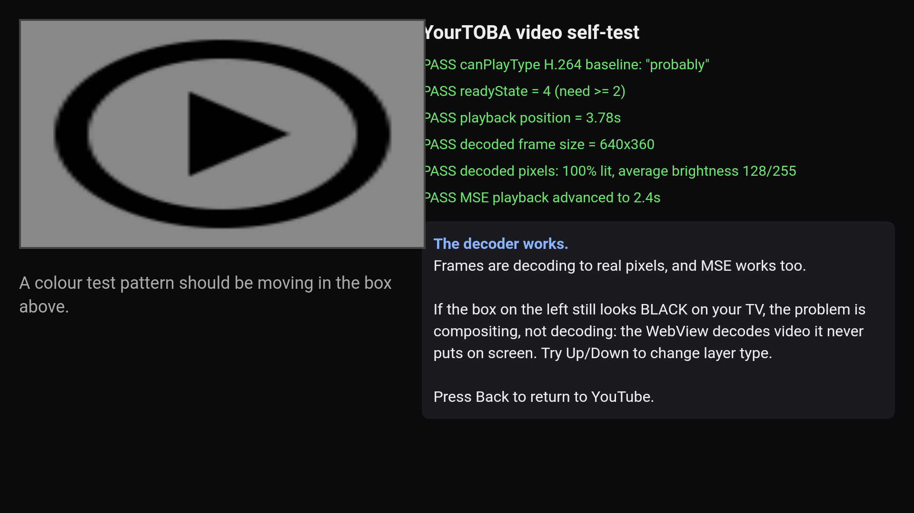

# YourTOBA

YouTube's TV interface on a Fire TV Stick, sideloaded, with the ads stripped
out of YouTube's own data before the player ever learns they exist.

The Android sibling of [YouTOBA](https://github.com/FromChaosComesClarity/youTOBA),
the macOS app. Same ad blocking, ported essentially verbatim. None of the rest.

Personal-use project, not affiliated with YouTube or Google.

> **A note on the name:** "toba" is Brazilian Portuguese slang for butthole.
> This was, allegedly, on purpose. The extra `r` was also on purpose.

## What it is

One Kotlin activity holding one WebView pointed at `youtube.com/tv`, the
Leanback interface that TVs and consoles get, with a Cobalt user agent so
YouTube serves it. Ad stripping is injected into the page before any YouTube
script runs.

Deliberately not included, because the brief was the TV interface and the ad
blocking: no downloader, no desktop mode, no browser cookie import, no
SponsorBlock.

## Requirements

- A Fire TV that runs **Fire OS**, which means Android underneath.
  **Not Vega OS.** Amazon's Fire TV Stick 4K Select (Oct 2025) and Fire TV
  Stick HD (2026) run Vega and cannot sideload anything at all. Check under
  Settings → My Fire TV → About.
- **`minSdk` is 21**, so Fire OS 5, 6, 7 and 8 all install. It was briefly 28,
  which silently excluded Fire OS 6 devices such as the first-generation Fire TV
  Stick 4K; see the troubleshooting note below.
- **A reasonably current WebView**, and this is the real constraint. See
  [WebView requirement](#webview-requirement).
- ADB debugging enabled on the device (see below).
- For building: JDK 17 and the Android SDK. `env.sh` points at a userspace
  install of both, so nothing needs root.

## Install

On the Fire TV, enable Settings → My Fire TV → Developer Options → **ADB
debugging**. If Developer Options is not there, open Settings → My Fire TV →
About, highlight the device name and press select seven times. The IP address
is under About → Network.

Then, from a machine on the same network:

```bash
./install.sh 192.168.1.42          # build, connect, install, launch
./install.sh 192.168.1.42 logs     # ...and tail the app's logcat
```

Accept the "Allow USB debugging?" prompt that appears on the TV the first time,
then run it again. YourTOBA lands on the Fire TV home row like any other app.

### Without ADB

If ADB is not an option, serve the APK to the TV over your LAN:

```bash
./serve.sh
```

It prints a URL. On the Fire TV, open the **Downloader** app, type that URL, and
install what it fetches.

### WebView requirement

YourTOBA renders YouTube's own TV site, so it is only ever as capable as the
device's WebView. Measured on Android TV emulators:

| WebView | Result |
|---|---|
| 66 (API 28 image) | Leanback boots and renders. Works. |
| 55 (API 25 image) | Blank screen. YouTube's own start-up scripts are refused. |

The WebView 55 failure is **not** caused by this app. With injection disabled
entirely, a plain WebView loading `youtube.com/tv` fails in exactly the same way
with the same two CSP script refusals. YouTube's bootstrap attaches its scripts
dynamically, and that engine will not run them. No shell can work around it.

If Leanback does not boot, the app stops showing a black rectangle and explains
itself, naming the WebView version it found:



If you land on that screen, try updating Amazon WebView or Chrome from the
Appstore. If there is no update available, the device is simply too old for a
WebView-based YouTube client, and a native one such as
[SmartTube](https://github.com/yuliskov/SmartTube) is the right answer, because
it talks to the innertube API directly and never renders YouTube's web UI.

Note for first-generation Fire TV Stick 4K owners: that device is
[not getting Fire OS 7](https://www.aftvnews.com/fire-tv-stick-4k-is-not-getting-fire-os-7-with-the-new-interface-update/),
and 6.7.1.1 is its final firmware. Its WebView can still be updated separately
from Fire OS, so the version the diagnostic reports is the number that matters,
not the Fire OS version.

### If the installer says "split or bad apk"

That message comes from a third-party installer, not from Android itself, and it
usually means one of three things.

1. **The APK's `minSdk` is higher than the device.** This was the actual cause
   on a Fire OS 6 device: the package declared `minSdk 28` while Fire OS 6 is
   Android 7.1 / API 25. The platform's own message is
   `INSTALL_FAILED_OLDER_SDK: Failed parse during installPackageLI`, and it is
   that word "parse" that sideload installers surface as "bad apk". Current
   builds declare `minSdk 21`. Check with
   `aapt2 dump badging dist/YourTOBA-0.1.0.apk | grep sdkVersion`.
2. **The APK lost its v1 signature.** Builds before 2026-09-06 were signed with
   the v2 scheme only, which Android 9+ accepts but several Fire TV sideload
   apps reject as malformed. Current builds are signed v1, v2 and v3. Check with
   `apksigner verify --verbose --min-sdk-version 21 dist/YourTOBA-0.1.0.apk`,
   which should report v1, v2 and v3 all true.
3. **The file was truncated or rewritten in transit.** Anything that proxies or
   re-encodes a download can do this. Compare the checksum on the device against
   `sha256sum dist/YourTOBA-0.1.0.apk`; `./serve.sh` prints it for you.
4. **The installer genuinely cannot handle a plain APK.** Some file managers only
   understand `.apks` bundles. Use Downloader, or `./install.sh`.

`./install.sh <ip>` avoids all of this, because `adb install` hands the package
straight to the platform installer and never goes near a third-party one.

## Using it

The remote works the way Leanback expects, because the d-pad already arrives as
real key events.

| Button | Does |
|---|---|
| D-pad, Select | Navigate, as normal |
| Back (press) | Back inside Leanback |
| Back (hold) | Exit the app |
| Menu (or Info) | Toggle the playback stats and settings overlay |
| Left / Right *(overlay open)* | Cycle the codec policy |
| Up / Down *(overlay open)* | Cycle layer type: none / hardware / software |
| Select *(overlay open)* | Run the video self-test |
| Home | Leaves the app, as always |

**Signing in** uses the `google.com/device` code flow, the one Google
explicitly supports for TV and limited-input apps. It just works, and it is the
reason none of the macOS app's browser-cookie-import machinery came along.

## Playback and codecs

On a first-generation Fire TV Stick 4K, most videos played with sound over a
black screen, some stuttered heavily, a few were fine.

The cause is a codec the hardware cannot decode. That stick decodes **H.264**
and HEVC in hardware. It has **no AV1 decoder**, and
[older Fire TV sticks do not hardware-decode VP9 either](https://forums.developer.amazon.com/questions/214779/firetv-youtube-stream-4k-support-vp9-codec-problem.html).
Chromium ships *software* decoders for both, so the WebView cheerfully answers
"supported" and YouTube serves them, leaving a quad Cortex-A53 to decode 1080p
in software. It drops every frame, which is the black picture with working
audio.

An early attempt blocked AV1 only. That made things strictly worse, because
everything then landed on VP9. The lesson is that on this hardware H.264 is the
only codec guaranteed to reach a hardware decoder, which is exactly the reasoning
behind [h264ify](https://github.com/Alex313031/Thorium-H264ify). So
**`h264-only` is the default.**

Leanback decides what to request through three separate APIs and all three have
to agree, so all three are patched: `MediaSource.isTypeSupported`,
`HTMLMediaElement.prototype.canPlayType`, and
`navigator.mediaCapabilities.decodingInfo`.

### Changing it from the sofa

The policy is switchable at runtime, because which codec a given device can
actually decode is not something that can be settled from a desk. Press **Menu**
for the overlay, then **Left/Right** to cycle:

| Policy | Blocks | Use when |
|---|---|---|
| `h264-only` | AV1, VP9 | **Default.** Old Fire TV hardware. |
| `no-av1` | AV1 | The device handles VP9 fine and you want better quality. |
| `all` | nothing | Modern hardware, or to compare against. |

**Up/Down** toggles the WebView between a hardware and a software layer. Forcing
a hardware layer is what other Leanback shells do, but an offscreen hardware
layer can break video overlay compositing, which is another documented cause of
audio-without-picture. Both settings persist across restarts.

The overlay also reports the codecs the player actually requested, the video
size, and the dropped frame count, so the answer comes from the device rather
than from inference.



### The video self-test

Press **Menu**, then **Select**, to run a bundled self-test. It plays a local
H.264 baseline file (no YouTube, no network) and reports what happened.



The trick is that it draws the video into a canvas and samples the pixels, which
reads the *decoded frame* independently of whether the compositor ever puts it
on screen. That separates two failures that look identical on a TV:

| Self-test says | Screen shows | Meaning |
|---|---|---|
| decoded pixels PASS | test pattern visible | The WebView is fine. The problem is YouTube-specific. |
| decoded pixels PASS | still black | **Compositing.** Frames decode but never reach the screen. Change layer type. |
| decoded pixels FAIL, position advances | black | The WebView cannot decode even H.264 baseline. No codec setting helps. |
| nothing advances | black | Video is dead in this WebView entirely. |

It also runs the same file through MSE from a fragmented MP4, because YouTube
plays exclusively through MSE. Progressive video working while MSE fails would
by itself explain a black picture on YouTube and a working local file.

### If none of the policies help

Worth knowing that this is a known, unsolved problem for WebView-based YouTube
clients on Fire TV: NoTubeTV carries
[an open issue](https://github.com/ycngmn/NoTubeTV/issues/21) with the same
symptom on the same hardware, where a tester reported that changing the user
agent, comparing codecs and switching layer types all failed to fix it, and
concluded Amazon's WebView fork is at fault.

## Why the official app plays video and this does not

Nothing that plays video well on a Fire TV renders it through a WebView. The
official YouTube app, Netflix, Prime Video and
[SmartTube](https://deepwiki.com/yuliskov/SmartTube) all do the same thing:
decode with **MediaCodec** and present into a **SurfaceView**, a surface the
system compositor scans out directly. SmartTube specifically is MediaServiceCore
plus ExoPlayer plus the InnerTube API, with no web engine anywhere.

A WebView has to do something much more awkward. It either composites video into
the page's texture layer, or it hole-punches: it cuts a transparent hole in the
page and puts a video surface behind it. Hole-punching is what breaks here.
Forcing `LAYER_TYPE_HARDWARE` renders the whole WebView into an *offscreen*
texture, and a surface behind an offscreen layer has nothing to show through to.
Audio plays, the page and its controls draw normally, and the video area stays
black. That is this app's exact symptom, and it is why `LAYER_TYPE_NONE` is now
the default: it is the only one of the three that leaves the normal overlay path
alone.

### The four ways forward, honestly

1. **Fix the compositing.** Layer type `none`, which had never actually been
   tried: the old toggle only ever chose between `hardware` and `software`, and
   both break video for different reasons. Cheap, and matches the symptom
   exactly. Try this first.
2. **Hybrid: Leanback UI, native player.** Keep the web UI, play video with
   ExoPlayer underneath. Much harder than it sounds, because Leanback does not
   hand you a stream URL: it feeds segments into MSE from JavaScript. Bridging
   that to a native player means intercepting MSE buffers, and the player UI
   then has to stay in sync with a surface it does not control.
3. **Go fully native.** InnerTube plus ExoPlayer, no WebView. This is the
   architecture that demonstrably works, and it makes ad blocking trivial
   because ad streams are simply never requested. It is also a rewrite, and it
   is precisely what SmartTube already is. Writing a second SmartTube is a
   poor use of an evening unless owning the code is the point.
4. **Bundle GeckoView.** Replace Amazon's WebView with Mozilla's engine, which
   is what a commenter on the NoTubeTV issue suggested. It sidesteps the broken
   engine and supports API 21+, but it adds tens of megabytes and nobody has
   shown Leanback working under it.

The self-test is what picks between these. If it reports decoded pixels while
the screen stays black, this is case 1 and worth pursuing. If it cannot decode a
local H.264 file at all, the WebView is a dead end on this device and only 3 or
4 are real, at which point [SmartTube](https://github.com/yuliskov/SmartTube) is
the sane answer and this project has been a good way to learn exactly why.

## Ad blocking

Two layers, and they are not equally important.

**1. Response stripping. This is the one that matters.** `adPlacements`,
`adSlots`, `playerAds` and known ad-renderer entries are removed directly from
YouTube's innertube JSON, via a persistent `fetch` and `JSON.parse` patch, plus
property guards on the `ytInitialData` and `ytInitialPlayerResponse` globals.
The player is handed a video that never had an ad attached, so there is no ad
to skip. Technique validated by [VacuumTube](https://github.com/shy1132/VacuumTube)
(MIT) and carried over from the macOS app.

The script is injected with `WebViewCompat.addDocumentStartJavaScript`, the
Android equivalent of an Electron preload: guaranteed to run before any of the
page's own JavaScript. That ordering guarantee is what the property guards
depend on. If the device's WebView is too old to support it, the app falls back
to injecting at `onPageStarted` and says so loudly in logcat. The fallback is
late enough to miss first paint but still lands before the innertube player
calls, which is where video ads live.

**2. Network blocking.** Ad and tracker hosts are refused in
`shouldInterceptRequest`. This replaces `@ghostery/adblocker-electron` from the
macOS app, which is Electron-only.

Worth being blunt about layer 2: it cannot stop video ads. YouTube serves ad
video from the same `googlevideo.com` hosts as real content, so no URL pattern
separates them. Layer 1 is what buys you an uninterrupted video. Layer 2 kills
trackers and banners. This is also why `AdBlockList.kt` must never block
`googlevideo.com`, and there is an explicit guard preventing it.

Cosmetic filtering is deliberately absent. On macOS it collided with YouTube's
own JS badly enough to crash the page, and that finding carried over.

### Measured, not assumed

Against real TVHTML5 innertube responses pulled on 2026-09-06:

- In a real `/youtubei/v1/player` response, `adPlacements`, `playerAds` and
  `adBreakHeartbeatParams` all sit at **depth 0**. The whole response nests only
  to depth 9. Video ad stripping has enormous margin.
- A real signed-out `/youtubei/v1/browse` home feed nests to **depth 19**. The
  macOS app's `MAX_DEPTH` of 14 truncated the walk before the bottom of a real
  feed, so a deeply nested sponsored tile could survive. Raised to 24 here, with
  a regression test at depth 19 that fails at 14 and passes at 24.

Known gap, inherited: some native and sponsored cards on the home feed use ad
formats outside what `AD_RENDERER_KEYS` currently targets and may still appear.
Those are tiles in a feed, not interruptions to a video.

## Tests

```bash
./test.sh
```

Runs the ad-stripping suite against `app/src/main/assets/yourtoba.js`, the exact
file the APK ships, inside a fake browser context. 13 cases covering the player
response, feed tiles, Shorts reel ads, the property guards, the fetch patch,
pass-through of non-ad endpoints, the depth ceiling, and the Back-key bridge.

## Building by hand

```bash
. ./env.sh
./gradlew assembleRelease
# app/build/outputs/apk/release/app-release.apk
```

The APK is signed with `app/sideload.keystore`, which is committed on purpose.
This is a personal sideload build, not a Play Store release, and losing the key
would mean uninstalling and reinstalling on the TV to change signer.

## The Fire TV banner

Fire TV shows apps on the home row using a **banner**, a 320x180 xhdpi image,
which is a different asset from the launcher icon. It is declared on both the
`<application>` and the leanback activity, and shipped at xhdpi and xxhdpi.

Fire OS caches launcher artwork aggressively, so a banner change often will not
appear on an update alone. To force it: uninstall, reinstall, and if it still
shows the old art, restart the device from Settings, My Fire TV, Restart.

## Layout

```
app/src/main/assets/yourtoba.js    the ad stripping (the actual asset)
app/src/main/java/.../MainActivity.kt   WebView host, UA handshake, key handling
app/src/main/java/.../AdBlockList.kt    network-level block rules
app/src/main/java/.../DocumentRewriter.kt  old-WebView injection fallback
tests/strip.test.mjs               ad-stripping test suite
docs/SCOPE.md                      why the port is shaped this way
docs/reference-preload.js          the original macOS preload, for diffing
install.sh                         build + sideload over network ADB
serve.sh                           serve the APK to the TV's Downloader app
emulator.sh                        run it on an Android TV emulator instead
docs/evidence/                     screenshots from the verification run
```

## What has been verified, and how

Verified on an **Android TV emulator running API 28**, the same API level as
Fire OS 7, against live YouTube servers. Reproduce with `./emulator.sh logs`.


- **Leanback loads.** YouTube serves the real TV interface to the Cobalt user
  agent, including its Cobalt-specific CSP directives and the `kabuki` Leanback
  bundle. The screenshot above is the app at 1920x1080.
- **The stripper runs in the page.** Live in-page state on `youtube.com/tv`:
  `__yourtobaInstalled: true`, `JSON.parse` patched, `fetch` patched, key bridge
  present.
- **Ads are actually stripped from live traffic.** A real
  `/youtubei/v1/player` call in the running app returns
  `"adBreakHeartbeatParams":"Q0FBJTNE"` on the wire, and the page receives `[]`.
  Raw bytes compared against the parsed object in the same session.
- **Network blocking fires.** `static.doubleclick.net/instream/ad_status.js`
  refused on load.
- **The old-WebView fallback works**, and finding that took two fixes. That
  emulator image ships WebView 66, far too old for `DOCUMENT_START_SCRIPT`, so
  it exercised the fallback and exposed both bugs described below.

Two real bugs the emulator caught, both fixed:

1. Injecting at `onPageStarted` runs against the document being navigated away
   from. It reported itself active on `about:blank` while the actual YouTube
   page got nothing. Replaced with the document rewrite in
   `DocumentRewriter.kt`, which inlines the script into the HTML itself.
2. The inlined script was then refused by YouTube's CSP, which is
   `script-src 'nonce-...' 'unsafe-eval'`. The rewriter now reuses the page's
   own nonce, falling back to whitelisting the script by SHA-256 hash. The
   policy stays exactly as strict as YouTube set it.

### Still needs the real TV

- **Playback performance.** The emulator renders through swiftshader, so it says
  nothing about whether a Fire TV Stick decodes smoothly, or at what resolution.
  This is the main open question.
- **Which injection path your stick takes.** If Amazon's WebView is recent
  enough you get the document-start path, which is cleaner than the fallback.
  The first log line tells you which.
- **The remote.** D-pad and Back are wired but untested against real hardware.

There is also an optional 4K viewport spoof, `SPOOF_4K` in `MainActivity.kt`,
off by default. Leanback picks its layout from the viewport, and forcing
3840x2160 is how other Leanback shells coax 4K out of it, but the compensating
scale factor depends on the display and a wrong value makes the UI unusable.
Ad blocking does not depend on it.

## Acknowledgments

- [VacuumTube](https://github.com/shy1132/VacuumTube) (MIT), for the TV user
  agent handshake and the response-stripping technique.
- [NoTubeTV](https://github.com/ycngmn/NoTubeTV) (GPL-3.0), read as prior art
  for the Android side. Not used as a base, and its two weakest choices are
  deliberately avoided here: it injects after page load rather than at document
  start, and it downloads its ad-block script from GitHub at every launch.
- [SmartTube](https://github.com/yuliskov/SmartTube), the mature native
  alternative, if you would rather install something than maintain something.
